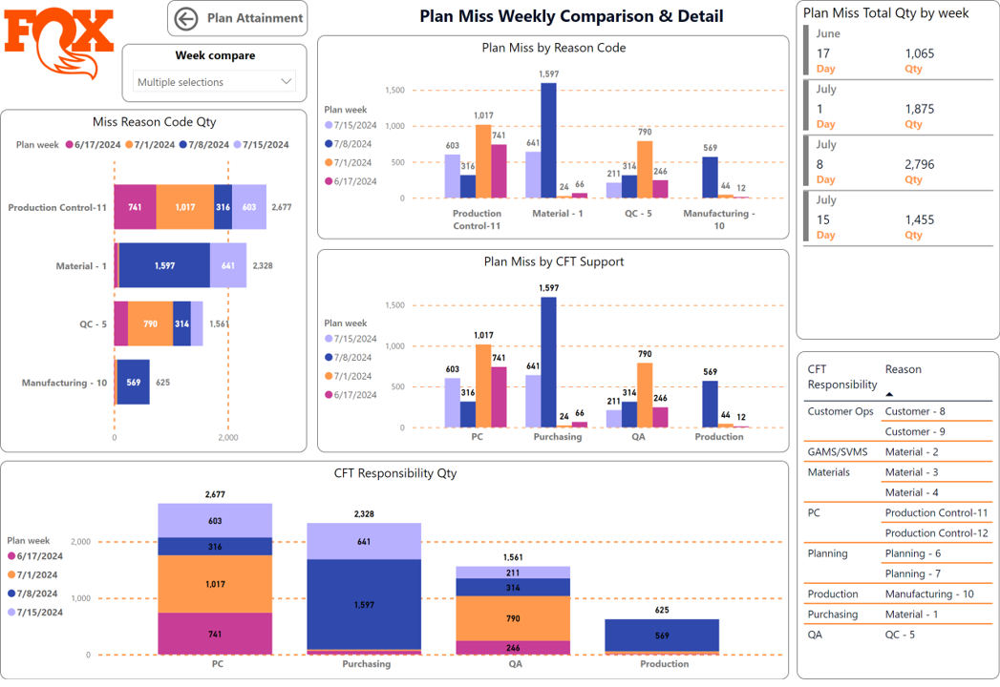

<h1>Supply Chain Planning Analytics &amp; Power BI Portfolio</h1>

<h2>Turning Supply Chain Data into Planning Decisions</h2>

Real-world planning tools for demand, supply, inventory, capacity, and operational execution.

**Contents:** [About Me](#about-me) · [At a Glance](#at-a-glance) · [1. ATP & Fulfillment](#1-atp--fulfillment-planning) · [2. Strategic SIOP](#2-strategic-siop-18-month-demand-planning) · [3. Material Shortage](#3-supply-chain-risk-intelligence-material-shortage-analysis) · [4. Demand Allocation](#4-customer-demand-allocation--booking-status) · [5. Demand vs. Capacity](#5-siop--demand-vs-capacity-planning) · [6. Schedule Attainment](#6-operational-excellence-schedule-attainment--job-miss-analysis)

---

## About Me

I am a supply chain planning professional with 8 years of experience in manufacturing and supply chain planning, including 7 years of hands-on experience using Power BI for data visualization and business intelligence. My strength lies in transforming ERP and operational data into planning dashboards that provide visibility into demand, supply, capacity, inventory, and schedule attainment. I work with Power BI (DAX measures) and Excel / Power Query to organize report data, and with SQL (basic querying).

**Background, separate from the dashboards below:** In my planning roles at Fox Factory (Gainesville, GA and Taichung, Taiwan), I supported operations representing approximately $600M in annual revenue (Taiwan operations) and contributed to $1M in inventory cost savings. The dashboards in this portfolio illustrate planning workflows and analytical tools I developed and used in support of those operations; they are not presented as the sole drivers of these business results.

**A note on this repository:** These projects are based on planning tools and dashboards from my actual planning work. This repository contains dashboard screenshots only — the underlying .pbix files and company data are not published — so each project below describes its data inputs, calculation logic, and the decisions the analysis supported, in place of the source files.

**How I approach each project:** Business problem → Data & assumptions → Analytical logic → Key findings → Decision supported → Limitations.

## At a Glance

| **200+** SKUs planned (Fox) | **$50M** material inventory | **~$600M** revenue supported — Taiwan operations |
| --- | --- | --- |
| **95%+** on-time delivery | **30+** product launches supported | **Monthly** S&OP reviews |

---

## 1. ATP & Fulfillment Planning

A Power BI planning tool I built to support available-to-promise (ATP) analysis and delivery-date commitments. It was used to check material availability against demand before forecast demand was converted into orders, and to test whether earlier customer order requests could be met.

*Figure 1 — ATP tool: week-by-week material availability vs. demand, gaps flagged up to 52 weeks out.*

<table>
<tr>
<td width="55%" valign="top">
<h4>Key Business Impact</h4>
<ul>
<li><strong>Faster commitment checks:</strong> Automated the inventory availability checks that support order commitment decisions, replacing manual lookups</li>
<li><strong>Earlier risk visibility:</strong> Identified potential supply gaps up to 52 weeks in advance, supporting proactive buffer-stock and planning discussions</li>
<li><strong>Shared planning view:</strong> Presented manufacturing receipts and U.S. sales demand in one view, so planning and sales worked from the same availability picture</li>
</ul>
</td>
<td width="45%" valign="top">

<strong>Tech stack:</strong> 
    

<strong>Decision supported:</strong> Whether to commit a delivery date, move it, or flag the order for a supply discussion before committing.

</td>
</tr>
</table>

<strong>Methodology & Business Logic</strong>

- **Demand:** Open orders and forecast demand by item
- **Supply:** On-hand inventory and expected inventory arrivals, by timing and quantity
- **Lead time:** A fixed lead-time value for each item (the value differs by item)
- **Logic:** Projected supply is compared against demand week by week to identify material gaps up to 52 weeks ahead
- **Commit-date basis:** The feasible commit date is based on the arrival date of the last required material — the latest material arrival among all items needed for the order
- **Output:** A commit-date recommendation and a view of where supply gaps would occur if demand was accepted as requested

<strong>Limitations</strong>

Lead times are entered as a fixed value per item, but actual arrival dates vary — so gap projections further out in the 52-week horizon are less certain than near-term results.

---

## 2. Strategic SIOP: 18-Month Demand Planning

A demand planning dashboard that visualizes an 18-month rolling demand outlook by category and SKU, including seasonal patterns, for use in SIOP (Sales, Inventory & Operations Planning) reviews.

*Figure 2 — 18-month demand outlook: forecast and sales-order view by quarter, category, and SKU.*

<table>
<tr>
<td width="55%" valign="top">
<h4>Key Business Impact</h4>
<ul>
<li><strong>Longer planning horizon:</strong> Translated demand signals into an 18-month rolling view to align demand with supply capabilities in SIOP reviews</li>
<li><strong>Seasonality insight:</strong> Made high- and low-demand periods visible to support inventory buffer discussions</li>
<li><strong>Drill-down capability:</strong> Allowed stakeholders to move from high-level categories down to individual SKU performance</li>
</ul>
</td>
<td width="45%" valign="top">

<strong>Tech stack:</strong> 
   

<strong>Decision supported:</strong> How to position inventory and supply plans ahead of seasonal demand changes.

</td>
</tr>
</table>

<strong>Methodology & Business Logic</strong>

- **Demand inputs:** Forecast demand provided for planning review, organized by category and SKU over an 18-month horizon
- **Comparison:** The rolling demand outlook is reviewed against supply capability as part of the SIOP process
- **Output:** Seasonal high/low periods and SKU-level drill-down views for planning discussion
- **Note:** This dashboard visualizes and structures forecast inputs for review. It does not claim a proprietary statistical forecasting model.

<strong>Limitations</strong>

A planning forecast is an estimate, not a confirmed customer commitment. The quality of the outlook depends on the forecast inputs and assumptions provided for review.

---

## 3. Supply Chain Risk Intelligence: Material Shortage Analysis

A dashboard that identifies material shortage risk by linking demand, material lead times, and supply availability, and shows where shortages could affect production.

*Figure 3 — Material shortage overview: items flagged by shortage timing and quantity against expected supply.*

<table>
<tr>
<td width="55%" valign="top">
<h4>Key Business Impact</h4>
<ul>
<li><strong>Earlier shortage visibility:</strong> Identified potential future shortages in time to support planning follow-up before production was affected</li>
<li><strong>Recurring risk patterns:</strong> Highlighted frequent shortage patterns by item and supplier, to flag recurring supply risks earlier</li>
<li><strong>Proactive mitigation:</strong> Linked demand forecasts with material lead times to calculate the shortage gap for review</li>
</ul>
</td>
<td width="45%" valign="top">

<strong>Tech stack:</strong> 
   

<strong>Decision supported:</strong> Which shortages to escalate first, and where to focus follow-up with planning and purchasing counterparts.

</td>
</tr>
</table>

<strong>Methodology & Business Logic</strong>

- **Demand:** Forecast and order demand by item
- **Supply constraints:** Material lead times and expected availability
- **Logic:** Demand is compared against expected supply timing to calculate the shortage gap — which items are short, by how much, and starting when
- **Output:** A prioritized shortage view for planning follow-up

<strong>Limitations</strong>

Shortage timing is based on current demand, lead times, and expected supply — if those inputs change, the shortage picture changes with them.

---

## 4. Customer Demand Allocation & Booking Status

A dashboard that shows how customer demand is distributed across months, products, and allocation buckets, and how booking status compares with the allocated bucket for key customers.

*Figure 4a — Customer demand share and volume by month.*

*Figure 4b — Key customer booking status against allocated buckets.*

<table>
<tr>
<td width="55%" valign="top">
<h4>Key Business Impact</h4>
<ul>
<li><strong>Allocation visibility:</strong> Visualized the distribution of customer demand and capacity allocation across key accounts, making over- and under-utilization easier to spot</li>
<li><strong>Priority review:</strong> Helped review whether key customer demand was booked within its allocation during peak cycles or material constraints</li>
<li><strong>Historical analysis:</strong> Analyzed past allocation patterns to support future capacity planning discussions</li>
</ul>
</td>
<td width="45%" valign="top">

<strong>Tech stack:</strong> 
   

<strong>Decision supported:</strong> How demand should be allocated across customers and months when capacity or materials are constrained.

</td>
</tr>
</table>

---

## 5. SIOP & Demand vs. Capacity Planning

A supply–demand balancing dashboard that compares demand against manufacturing capacity to identify gaps, bottlenecks, and capacity utilization by period, for use in S&OP reviews.

*Figure 5a — Monthly demand vs. capacity review.*

*Figure 5b — Capacity scheduling: loading, reserve, and available space by period.*

<table>
<tr>
<td width="55%" valign="top">
<h4>Key Business Impact</h4>
<ul>
<li><strong>Capacity visibility:</strong> Displayed capacity utilization by period, identifying when and where capacity was tight</li>
<li><strong>Gap closure:</strong> Side-by-side demand vs. capacity charts highlighted supply–demand mismatches for S&OP resolution</li>
<li><strong>Scenario planning:</strong> Used sales forecasts to run what-if scenarios and support long-term capacity planning discussions</li>
</ul>
</td>
<td width="45%" valign="top">

<strong>Tech stack:</strong> 
    

<strong>Decision supported:</strong> Where demand and capacity do not balance, and which scenario to carry into the S&OP plan.

</td>
</tr>
</table>

---

## 6. Operational Excellence: Schedule Attainment & Job-Miss Analysis

A performance review dashboard tracking production schedule attainment across manufacturing lines, with a breakdown of job-miss reasons.

*Figure 6a — Schedule attainment by line and period.*

*Figure 6b — Job-miss reasons breakdown (material, manufacturing, quality, planning).*

<table>
<tr>
<td width="55%" valign="top">
<h4>Key Business Impact</h4>
<ul>
<li><strong>Root cause identification:</strong> Categorized job-miss reasons (e.g., material, manufacturing, quality, planning) to support accountability discussions across departments</li>
<li><strong>Performance transparency:</strong> Provided visibility into production adherence, reducing manual reporting time by 30%</li>
<li><strong>Decision support:</strong> Helped managers spot recurring miss patterns and bottlenecks and discuss resource reallocation to protect delivery commitments</li>
</ul>
</td>
<td width="45%" valign="top">

<strong>Tech stack:</strong> 
   

<strong>Decision supported:</strong> Which miss reasons to address first, and where schedule or resource adjustments are needed.

</td>
</tr>
</table>
