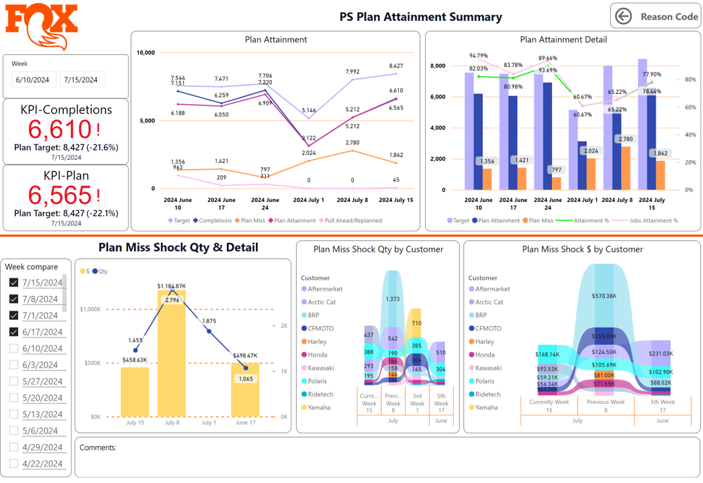

# Supply Chain Planning Analytics & Power BI Portfolio

## About Me
I am a supply chain planning professional with over 7 years of experience using Power BI for data visualization and business intelligence. My strength is data visualization: turning ERP and operational data into planning dashboards that cover demand, supply, capacity, inventory, and schedule attainment. I work with Power BI (DAX measures) and Excel / Power Query to organize report data, and with SQL (basic querying).

**Background, separate from the dashboards below:** In my planning roles at Fox Factory (Gainesville, GA and Taichung, Taiwan), I supported ~$600M in annual revenue (Taiwan operations) and contributed to $1M in inventory cost savings. The projects in this portfolio illustrate the planning workflows behind that work. They are examples of the analysis tools I built and used — they are not presented as the sole cause of those business results.

**A note on this repository:** These projects are based on planning tools and dashboards from my actual planning work. This repository contains dashboard screenshots only — the underlying .pbix files and company data are not published — so each project below describes its data inputs, calculation logic, and the decisions the analysis supported, in place of the source files.

**How I approach each project:** Business problem → Data & assumptions → Analytical logic → Key findings → Decision supported → Limitations.

## 1. ATP & Fulfillment Planning

### Description
A Power BI planning tool I built to support available-to-promise (ATP) analysis and delivery-date commitments. It was used to check material availability against demand before forecast demand was converted into orders, and to test whether earlier customer order requests could be met.

### Tech Stack
Power BI (DAX), SQL (basic querying), Oracle / Epicor ERP data

### Dashboard

### Methodology & Business Logic

- **Demand:** Open orders and forecast demand by item
- **Supply:** On-hand inventory and expected inventory arrivals, by timing and quantity
- **Lead time:** A fixed lead-time value for each item (the value differs by item)
- **Logic:** Projected supply is compared against demand week by week to identify material gaps up to 52 weeks ahead
- **Commit-date basis:** The feasible commit date is based on the arrival date of the last required material — the latest material arrival among all items needed for the order
- **Output:** A commit-date recommendation and a view of where supply gaps would occur if demand was accepted as requested

### Key Business Impact
**Faster commitment checks:** Automated the inventory availability checks that support order commitment decisions, replacing manual lookups
**Earlier risk visibility:** Identified potential supply gaps up to 52 weeks in advance, supporting proactive buffer-stock and planning discussions
**Shared planning view:** Presented manufacturing receipts and U.S. sales demand in one view, so planning and sales worked from the same availability picture

**Decision supported:** Whether to commit a delivery date, move it, or flag the order for a supply discussion before committing.

**Limitations:** Lead times are entered as a fixed value per item, but actual arrival dates vary — so gap projections further out in the 52-week horizon are less certain than near-term results.

## 2. Strategic SIOP: 18-Month Demand Planning

### Description
A demand planning dashboard that visualizes an 18-month rolling demand outlook by category and SKU, including seasonal patterns, for use in SIOP (Sales, Inventory & Operations Planning) reviews.

### Tech Stack
Power BI (DAX), Scenario Planning

### Dashboard

### Methodology & Business Logic
**Demand inputs:** Forecast demand provided for planning review, organized by category and SKU over an 18-month horizon

**Comparison:** The rolling demand outlook is reviewed against supply capability as part of the SIOP process

**Output:** Seasonal high/low periods and SKU-level drill-down views for planning discussion

**Note:** This dashboard visualizes and structures forecast inputs for review. It does not claim a proprietary statistical forecasting model.

### Key Business Impact

**Longer planning horizon:** Translated demand signals into an 18-month rolling view to align demand with supply capabilities in SIOP reviews
**Seasonality insight:** Made high- and low-demand periods visible to support inventory buffer discussions
**Drill-down capability:** Allowed stakeholders to move from high-level categories down to individual SKU performance

**Decision supported:** How to position inventory and supply plans ahead of seasonal demand changes.

**Limitations:** A planning forecast is an estimate, not a confirmed customer commitment. The quality of the outlook depends on the forecast inputs and assumptions provided for review.

## 3. Supply Chain Risk Intelligence: Material Shortage Analysis

### Description
A dashboard that identifies material shortage risk by linking demand, material lead times, and supply availability, and shows where shortages could affect production.

### Tech Stack
Power BI (DAX), MRP logic

### Dashboard

### Methodology & Business Logic
**Demand:** Forecast and order demand by item

**Supply constraints:** Material lead times and expected availability

**Logic:** Demand is compared against expected supply timing to calculate the shortage gap — which items are short, by how much, and starting when

**Output:** A prioritized shortage view for planning follow-up

### Key Business Impact

**Earlier shortage visibility:** Identified potential future shortages in time to support planning follow-up before production was affected
**Recurring risk patterns:** Highlighted frequent shortage patterns by item and supplier, to flag recurring supply risks earlier
**Proactive mitigation:** Linked demand forecasts with material lead times to calculate the shortage gap for review

**Decision supported:** Which shortages to escalate first, and where to focus follow-up with planning and purchasing counterparts.

**Limitations:** Shortage timing is based on current demand, lead times, and expected supply — if those inputs change, the shortage picture changes with them.

  
## 4. Customer Demand Allocation & Booking Status

### Description
A dashboard that shows how customer demand is distributed across months, products, and allocation buckets, and how booking status compares with the allocated bucket for key customers.

### Tech Stack
Power BI (DAX), Capacity Planning

### Dashboard

### Key Business Impact

**Allocation visibility:** Visualized the distribution of customer demand and capacity allocation across key accounts, making over- and under-utilization easier to spot
**Priority review:** Helped review whether key customer demand was booked within its allocation during peak cycles or material constraints
**Historical analysis:** Analyzed past allocation patterns to support future capacity planning discussions

**Decision supported:** How demand should be allocated across customers and months when capacity or materials are constrained.

## 5. Global SIOP & Demand vs. Capacity Planning

### Description
A supply–demand balancing dashboard that compares demand against manufacturing capacity to identify gaps, bottlenecks, and capacity utilization by period, for use in S&OP reviews. 

### Tech Stack
Power BI (DAX), S&OP Modeling, Scenario Planning

### Dashboard

### Key Business Impact

**Capacity visibility:** Displayed capacity utilization by period, identifying when and where capacity was tight
**Gap closure:** Side-by-side demand vs. capacity charts highlighted supply–demand mismatches for S&OP resolution
**Scenario planning:** Used sales forecasts to run what-if scenarios and support long-term capacity planning discussions

**Decision supported:** Where demand and capacity do not balance, and which scenario to carry into the S&OP plan.

## 6. Operational Excellence: Schedule Attainment & Job-Miss Analysis

### Description
A performance review dashboard tracking production schedule attainment across manufacturing lines, with a breakdown of job-miss reasons.

### Tech Stack 
Power BI (DAX), SQL (basic querying)

### Dashboard

### Key Business Impact

**Root cause identification:** Categorized job-miss reasons (e.g., material, manufacturing, quality, planning) to support accountability discussions across departments
**Performance transparency:** Provided visibility into production adherence, reducing manual reporting time by 30%
**Decision support:** Helped managers spot recurring miss patterns and bottlenecks and discuss resource reallocation to protect delivery commitments

**Decision supported:** Which miss reasons to address first, and where schedule or resource adjustments are needed.
