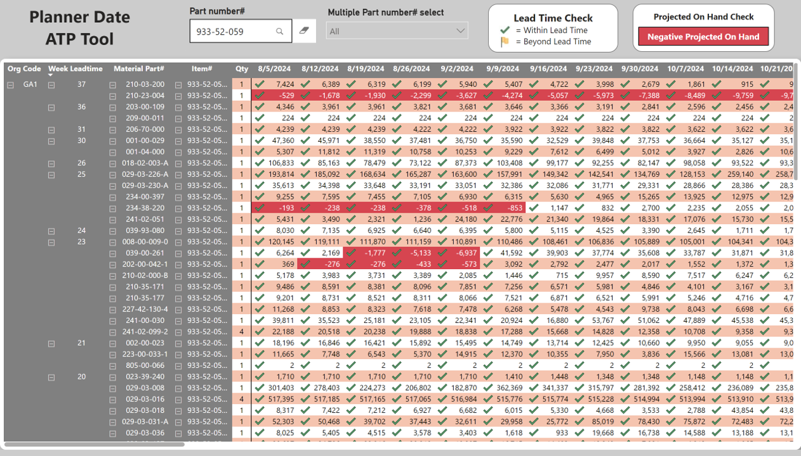
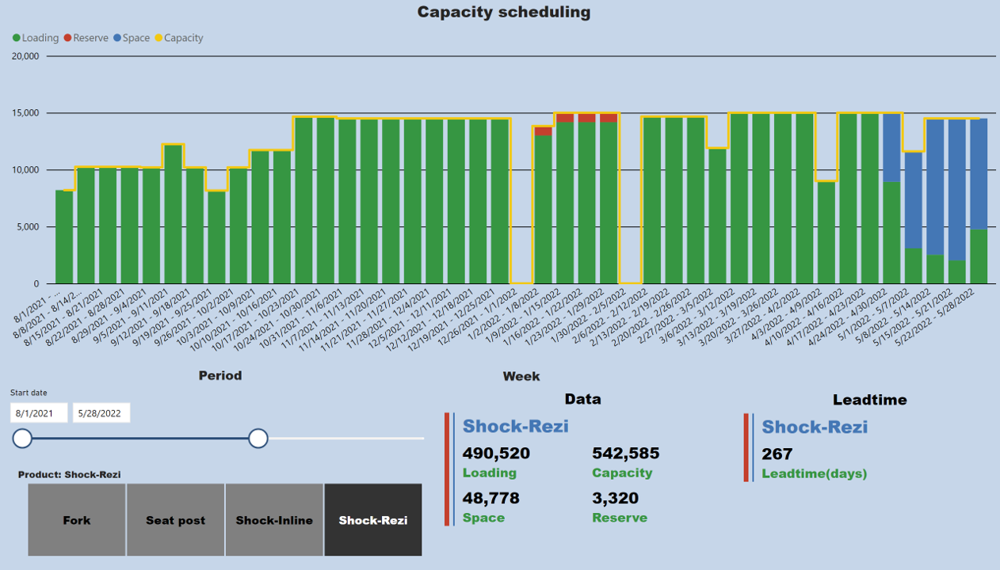

# Supply Chain Planning Analytics & Power BI Portfolio

# About Me
I am a supply chain planning professional with over 7 years of experience using Power BI for data visualization and business intelligence. My strength is data visualization: turning ERP and operational data into planning dashboards that cover demand, supply, capacity, inventory, and schedule attainment. I work with Power BI (DAX measures) and Excel / Power Query to organize report data, and with SQL (basic querying).

** Background, separate from the dashboards below:** In my planning roles at Fox Factory (Gainesville, GA and Taichung, Taiwan), I supported ~$600M in annual revenue (Taiwan operations) and contributed to $1M in inventory cost savings. The projects in this portfolio illustrate the planning workflows behind that work. They are examples of the analysis tools I built and used — they are not presented as the sole cause of those business results.

** A note on this repository:** These projects are based on planning tools and dashboards from my actual planning work. This repository contains dashboard screenshots only — the underlying .pbix files and company data are not published — so each project below describes its data inputs, calculation logic, and the decisions the analysis supported, in place of the source files.

** How I approach each project:** Business problem → Data & assumptions → Analytical logic → Key findings → Decision supported → Limitations.

# 1. ATP & Fulfillment Planning

## Description
A Power BI planning tool I built to support available-to-promise (ATP) analysis and delivery-date commitments. It was used to check material availability against demand before forecast demand was converted into orders, and to test whether earlier customer order requests could be met.

## Tech Stack
Power BI (DAX), SQL (basic querying), Oracle / Epicor ERP data

## Dashboard

## Methodology & Business Logic

#### Demand: 
Open orders and forecast demand by item
#### Supply: 
On-hand inventory and expected inventory arrivals, by timing and quantity
#### Lead time: 
A fixed lead-time value for each item (the value differs by item)
#### Logic: 
Projected supply is compared against demand week by week to identify material gaps up to 52 weeks ahead
#### Commit-date basis: 
The feasible commit date is based on the arrival date of the last required material — the latest material arrival among all items needed for the order
#### Output: 
A commit-date recommendation and a view of where supply gaps would occur if demand was accepted as requested

## Key Business Impact
#### Faster commitment checks: 
Automated the inventory availability checks that support order commitment decisions, replacing manual lookups
#### Earlier risk visibility: 
Identified potential supply gaps up to 52 weeks in advance, supporting proactive buffer-stock and planning discussions
#### Shared planning view: 
Presented manufacturing receipts and U.S. sales demand in one view, so planning and sales worked from the same availability picture

## Decision supported: 
Whether to commit a delivery date, move it, or flag the order for a supply discussion before committing.

## Limitations: 
This is a planning analysis tool. Its outputs depend on the accuracy and refresh timing of the underlying demand, inventory, and supply data, and it does not by itself guarantee supplier delivery or customer fulfillment.

# 2. Strategic SIOP: 18-Month Demand Architecture

## Description
A sophisticated demand modeling engine designed to visualize long-term trajectories by leveraging growth trends, seasonality, and market signals.

## Tech Stack
Power BI, Statistical Forecasting, Scenario Planning.

## Dashboard

## Key Business Impact

### -Strategic Alignment: 
Translates complex demand signals into 18-month rolling forecasts to align million-dollar revenue goals with supply capabilities.
### -Seasonality Insight: 
Identifies high/low demand periods (holidays, special events) to optimize inventory buffer strategies.
### -Drill-Down Capability: 
Allows stakeholders to navigate from high-level categories down to individual SKU performance seamlessly.

# 3. Supply Chain Risk Intelligence & Revenue Protection Hub

## Description
A comprehensive risk management dashboard that quantifies the financial impact of material shortages and supplier volatility.

## Tech Stack
MRP Logic Integration, Risk Modeling, Power BI.

## Dashboard

## Key Business Impact

### -Revenue Protection: 
Predicts potential future shortages, allowing the team to secure alternative supply sources before production downtime occurs.
### -Supplier Performance: 
Highlights frequent shortage patterns associated with specific suppliers to improve procurement negotiations.
### -Proactive Mitigation: 
Links demand forecasts with material lead times to calculate the "Shortage Gap" in real-time.
  
# 4. Manufacturing Cost Intelligence & E&O Mitigation Suite

## Description
A financial-operations hybrid dashboard focused on inventory health and production cost transparency.

## Tech Stack
Power BI, Capacity Planning, Stakeholder Analytics.

## Dashboard

## Key Business Impact

### -Resource Optimization: 
Visualizes the distribution of capacity across key accounts to prevent over/under-utilization of manufacturing lines.
### -Priority Management: 
Ensures "Must-Win" customer demands are prioritized during peak cycles or material constraints.
### -Historical Analysis:
Analyzes past allocation patterns to guide future multi-year capacity investment decisions.

# 5. Global SIOP & Multi-Constraint Capacity Governance Hub

## Description
A supply-demand balancing dashboard that compares manufacturing capabilities against actual sales order signals to identify scaling opportunities. 

## Tech Stack
Power BI, S&OP Modeling, Predictive Analytics.

## Dashboard

## Key Business Impact

### -Scalability Analysis: 
Displays real-time capacity utilization percentage, identifying when and where to scale production infrastructure.
### -Gap Closure: 
Side-by-side charts highlight "Supply-Demand Mismatches," enabling faster S&OP (Sales and Operations Planning) resolution.
### -Predictive Planning: 
Incorporates sales forecasts to simulate "What-If" scenarios, optimizing long-term capital expenditure.

# 6. Operational Excellence: Schedule Attainment & Efficiency Analytics

## Description
A tactical performance review program tracking job attainment and labor efficiency across multiple manufacturing lines.

## Tech Stack 
Power BI (Advanced DAX), SQL(basic querying).

## Dashboard

## Key Business Impact

### -Root Cause Identification: 
Categorizes "Job Miss" reasons (e.g., material shortage, headcount, equipment) to drive data-driven accountability across departments.
### -Performance Transparency: 
Provides real-time visibility into production adherence, reducing manual reporting time by 30%.
### -Decision Support: 
Enables managers to identify bottlenecks instantly and reallocate resources to maintain delivery commitments.
